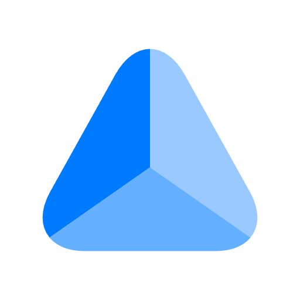
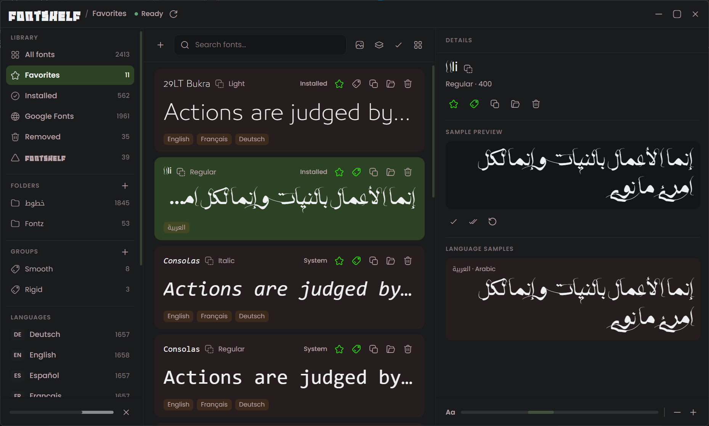
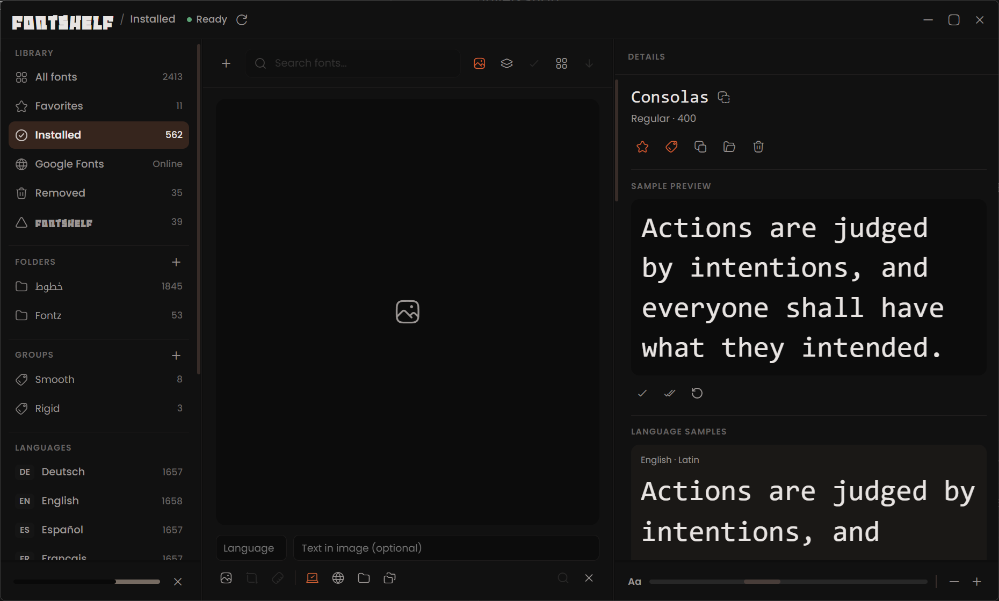

  

<h1 align="center">FontShelf</h1>

  

---

## Overview

**FontShelf** (`v1.0.0`) brings every typeface you work with into one clean, native **Windows 11 (`x64`)** workspace — installed system fonts, per-user fonts, unlimited local folders, 39 curated offline bundled fonts, and over 2,000 Google Fonts — with **offline visual font identification**, **image-extracted custom themes**, and **13+ language previews**.

Pay once and own your studio forever: **no subscriptions, no accounts, and zero tracking.**

---

## Key Features

### 1. Offline Visual Font Search (Search by Image)
- **Paste or Drop Any Image** — Press `Ctrl+V`, drag-and-drop, or pick any screenshot, poster, or logo.
- **Interactive Crop & Auto-Level** — Draw a tight selection around any line of lettering and automatically straighten tilted text before matching.
- **100% On-Device Cross-Language Matching** — Ranks the Top-10 visually similar fonts across all supported scripts completely offline across **Local fonts**, **Watched Folders**, **Bundled fonts**, and **2,000+ pre-indexed Google Fonts**.
- **Source Switching & Live Re-Scoring** — Switch match sources on the fly, add optional text or language hints, and preview custom text live across matched results.

### 2. Dynamic Themes From Any Image
- **Extract Palettes Automatically** — Drop any photo or brand artwork onto the bottom-left theme panel (or click `+`) to theme the entire app in harmonious, contrast-safe **Dark** or **Light** color schemes.
- **Classic Defaults Anytime** — Toggle seamlessly between Obsidian Dark, Daylight Light, and your extracted custom palette with one-click reset.

### 3. Unified Font Library, Built-In Google Fonts & Safe Per-User Management
- **All Sources Together** — Manage per-user **Installed** fonts, read-only Windows **System** fonts (in their own dedicated tab), a smart **Recent** activity tab (up to 100 entries), unlimited local folders (without installing them to Windows), and the **FontShelf** tab uniting **39 offline bundled fonts** (*Poppins*, *Noto Sans*, *Al-Jazeera*) alongside every font installed via FontShelf.
- **2,000+ Google Fonts Built In** — Open the **Google** tab to preview live fonts directly inside FontShelf and favorite, organize into groups, copy, or install straight to your Windows account in one click — no browser downloads or ZIP extraction.
- **Uninstall All FontShelf Fonts & Safe Restore** — FontShelf tracks every font it installs. Click the uninstall-all icon next to `+` in the **FontShelf** tab and complete the 2-step confirmation in the right panel to cleanly uninstall exclusively FontShelf-installed fonts (originals go to the Windows Recycle Bin and stay restorable from the **Removed** tab).
- **In-App Windows Font Access & Uninstall Info** — Click the shield-alert button next to the right-panel `Aa` slider anytime to view per-user paths, copy them, or review Windows Settings uninstall steps right inside the side panel.

### 4. Multilingual Preview Engine (13+ Languages & RTL)
- **Automatic Script Detection** — Native samples across English, Arabic (RTL), French, German, Spanish, Greek, Russian, Hebrew (RTL), Hindi, Thai, Japanese, Korean, and Simplified Chinese.
- **Live Inline Sample Editor** — Type custom text in the Details panel and apply it to one font or across your entire library, adjust sample size smoothly (`Aa` slider), or drag overflowing rows downward to peek at longer lines.

### 5. Layouts, Grouping & Fast Bulk Organization
- **List View & Grid View** — Switch layouts instantly and resize sidebar, list, and details panels to fit your screen.
- **Smart Family Grouping** — Collapse multi-weight families into clean cards and expand every style inline with one click.
- **Combinable Multi-Filters (`Ctrl+Click`)** — Intersect any combination of scopes, folders, custom groups, favorites, and languages simultaneously.
- **Select Mode & Bulk Actions** — Batch favorite, assign to custom groups via a clean floating picker, copy font files, copy font names, install, remove, or restore.
- **Drag-and-Drop & Context Menus** — Drag fonts directly onto sidebar Folders, Groups, Favorites, Installed, or Removed tabs, and access concise right-click menus across every part of the app.

### 6. Lightweight, Private & Ready to Resume
- **Native Windows Engine** — Built with Rust + WebView2 and virtualized rendering for smooth scrolling over thousands of fonts with low memory usage.
- **Instant Session Resume** — Automatically restores your window position, panel sizes, active tab state, filters, zoom level, and scroll positions every time you reopen FontShelf.

---

## Visual Tour

<table>
  <tr>
    <td width="50%">
      
      
<strong>Amber Dark Theme</strong> — Dynamic image palette with Arabic &amp; Latin previews

    </td>
    <td width="50%">
      
      
<strong>Daylight Light Theme</strong> — High-contrast light workspace

    </td>
  </tr>
  <tr>
    <td width="50%">
      
      
<strong>Forest Emerald Theme</strong> — Custom palette extracted from imagery

    </td>
    <td width="50%">
      
      
<strong>Search by Image</strong> — Drop or paste any image to find matching fonts offline

    </td>
  </tr>
</table>

---

## Shortcuts & Workflow Tips

| Action | Shortcut / Gesture |
|--------|--------------------|
| Focus font search | `Ctrl + K` |
| Combine sidebar filters (Scopes, Folders, Groups, Languages) | `Ctrl + Click` |
| Paste image into Search by Image | `Ctrl + V` |
| Select font range | `Shift + Click` |
| Toggle multi-selection | `Ctrl + Click` on font rows |
| Navigate fonts | `Arrow Up` / `Arrow Down` |
| Zoom interface in / out | `Ctrl +` / `Ctrl -` |
| Toggle maximize | `F11` |
| Close panel, menu, or selection | `Escape` |
| Peek full overflowing sample text | Drag bottom edge of any list row |

---

## System Requirements & Privacy

- **OS:** Windows 11 (version 10.0.22000.0 or higher)
- **Architecture:** 64-bit (`x64`)
- **Offline Support:** All core features — including visual font search across local, folder, bundled, and indexed Google Fonts — work completely offline. Internet is only needed when browsing or downloading new Google Fonts.
- **Privacy:** Your fonts and images stay on your device. Zero accounts, zero tracking, zero uploads.
- **Windows Font Safety:** Uses Windows 11 MSIX Flexible Virtualization strictly scoped to `%LOCALAPPDATA%\Microsoft\Windows\Fonts` and `HKCU\Software\Microsoft\Windows NT\CurrentVersion\Fonts`. Windows system fonts (`%WINDIR%\Fonts` / `HKLM`) are strictly read-only, non-FontShelf fonts are protected by explicit confirmation prompts, and FontShelf includes one-click removal of all FontShelf-installed fonts.

---

## Official Links

- **Microsoft Store:** https://apps.microsoft.com/detail/9MT69GPXZ0S9
- **Website:** https://tellawy.github.io/FontShelf/
- **Download:** https://tellawy.github.io/FontShelf/download.html
- **Privacy Policy:** https://tellawy.github.io/FontShelf/privacy.html
- **Support & Technical Disclosure:** https://tellawy.github.io/FontShelf/support.html
